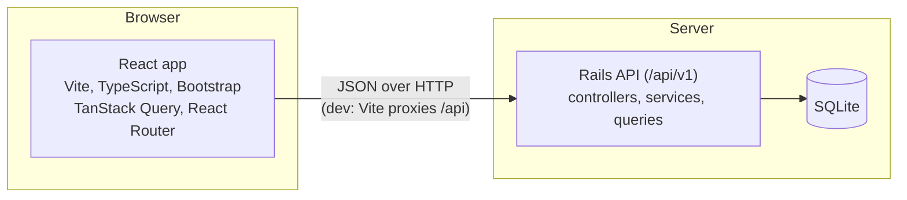
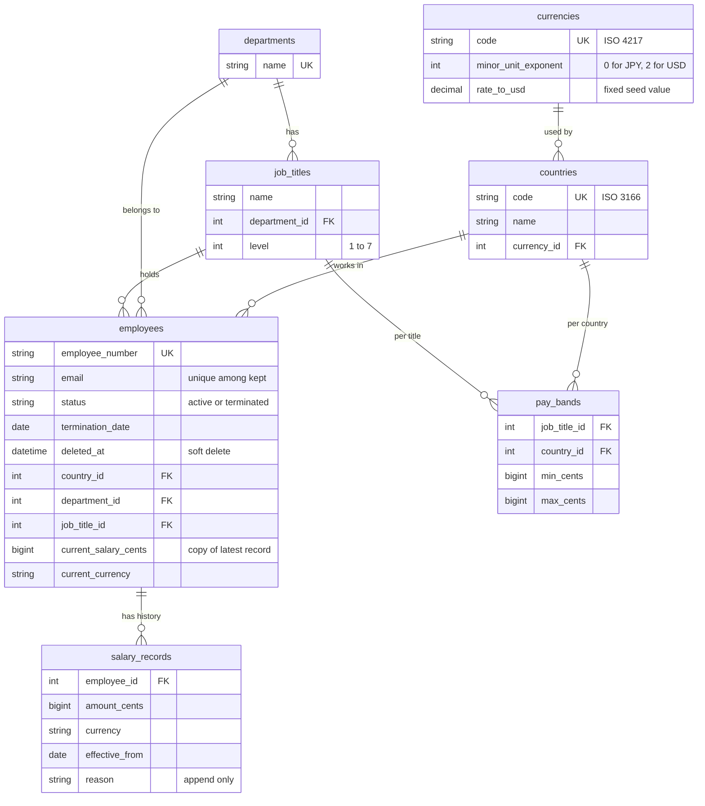
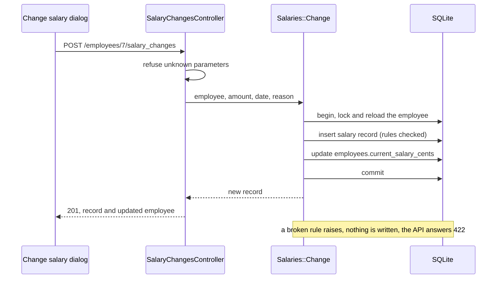
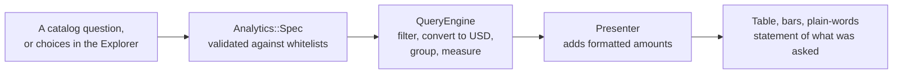

# Architecture

A small web app for an HR manager to manage salary data for about 10,000 employees across several countries. A React single-page app talks JSON to a Rails API backed by SQLite.

In development the Vite server proxies `/api` to Rails, so the browser makes same-origin calls. If the UI is ever served from another origin, `CORS_ORIGINS` opts that origin in.

## Data model

Amounts are integers in minor units. `employees.current_salary_cents` is a copy of the newest `salary_records` row, kept in step by one service. See `DESIGN_NOTES.md` for why.

## Backend (`backend/`)

Plain Rails, with the logic pulled out of controllers into small, named pieces.

| Layer | Where | Role |
|---|---|---|
| Controllers | `app/controllers/api/v1` | Parse parameters, call one service or query, render JSON. Nothing else. |
| Concerns | `app/controllers/concerns` | `ErrorHandling` (one error shape), `StrictParams` (refuse unknown keys), `FindsEmployee`. |
| Services | `app/services` | Every write. `Employees::Create`, `Terminate`, `Rehire`, `SoftDelete`, `Restore`; `Salaries::Change`. Each is one transaction and raises `RecordInvalid` on a broken rule. |
| Queries | `app/queries` | Reads. `EmployeeSearch`: filters, sorting, keyset pagination. |
| Analytics | `app/services/analytics`, `app/services/questions` | Pay figures, computed on request. `Spec` (a validated question), `QueryEngine`, `Percentile`; the insights `GenderPayGap`, `OutOfBand`, `StaleSalaries`; and the fixed `Questions::Catalog` that names the common questions. |
| Models | `app/models` | Validations and relationships; `Money` is a small value object. |
| Presenters | `app/presenters` | Shape JSON for employees, salary records and each kind of analytics result. |
| Edge | `lib/middleware`, `config/initializers` | Request size limit, opt-in CORS. `app/errors` holds the JSON exceptions app. |
| Seeding | `app/services/seeds`, `db/seeds.rb` | Reference data and the reproducible 10,000-employee generator. |

**A salary change, end to end**

## Pay analytics

One path serves the dashboard, the Questions page and the Explorer, so a figure is the same wherever it appears.

- **Exact and comparable.** Each salary is converted to USD cents with the same half-up `Money` arithmetic used everywhere, then grouped and measured in Ruby, with percentiles by linear interpolation. See `DESIGN_NOTES.md` for why this is not done in SQL.
- **Questions are definitions, not guesses.** A catalog question is a fixed name plus the exact parameters it runs, so it always means the same calculation.
- **The like-for-like gender gap** compares women with men in the same job title and country, then combines those comparisons, and flags results that rest on few people.

## Frontend (`frontend/src`)

| Folder | Role |
|---|---|
| `api/` | The typed client and one hook per endpoint (TanStack Query). The only code that knows URLs. `ApiError` carries the server's code and per-field messages. |
| `pages/` | One component per route: list, detail, create, edit, not found. |
| `features/employees/` | The pieces the pages are built from: table, filters, forms, dialogs, and the hooks for URL state and paging. |
| `lib/` | Pure helpers: money parsing, formatting, labels, error wording. |
| `features/analytics/` | The pay screens' pieces: the table with bars, the gender-gap and finding lists, the Explorer's controls and its address handling. |
| `components/` | The layout shell: navigation, skip link, focus handling. |
| `test/` | Shared test infrastructure: MSW server, fixtures, render helpers, the axe check. |

**State.** Server data lives in TanStack Query. The list's view (sort, page size, filters) lives in the URL. The cursor trail for "Previous" lives in component state, because the API only moves forward. Forms keep what is typed in local state and map the API's field names back to their fields.

## Quality

- **Backend:** 482 specs, about 99.9% line and 98.9% branch coverage, rubocop, Brakeman and bundler-audit clean.
- **Frontend:** 452 tests (components, hooks, flows, and an accessibility audit of every screen), lint and format clean, type-checked build.
- **CI:** two workflows in `.github/workflows` run the above on each push and pull request.
- **Performance:** measurements are in `PERFORMANCE.md`; a list page takes a few milliseconds on 10,000 rows.

## Boundaries

On hold, not built: CSV export and a free-text question box. Not covered: authentication, deployment. See `DESIGN_NOTES.md` ("Not built, on purpose") and `IMPLEMENTATION_PLAN.md`.
